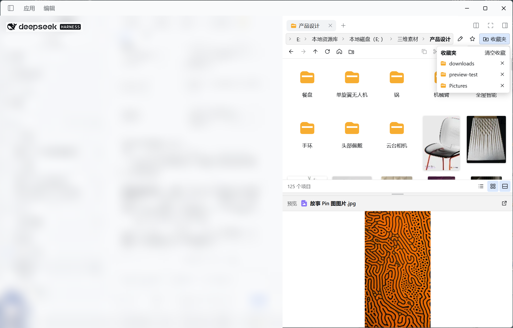
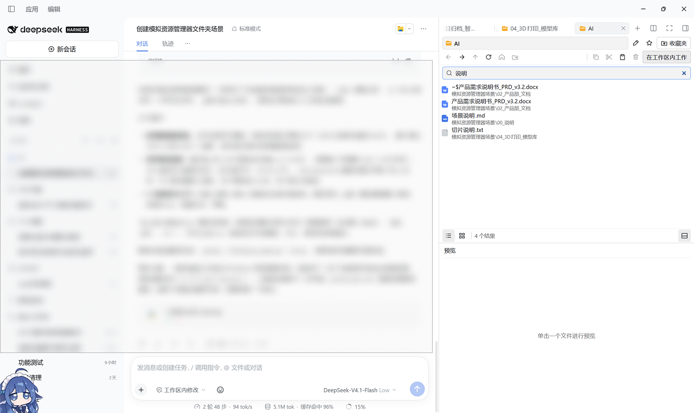
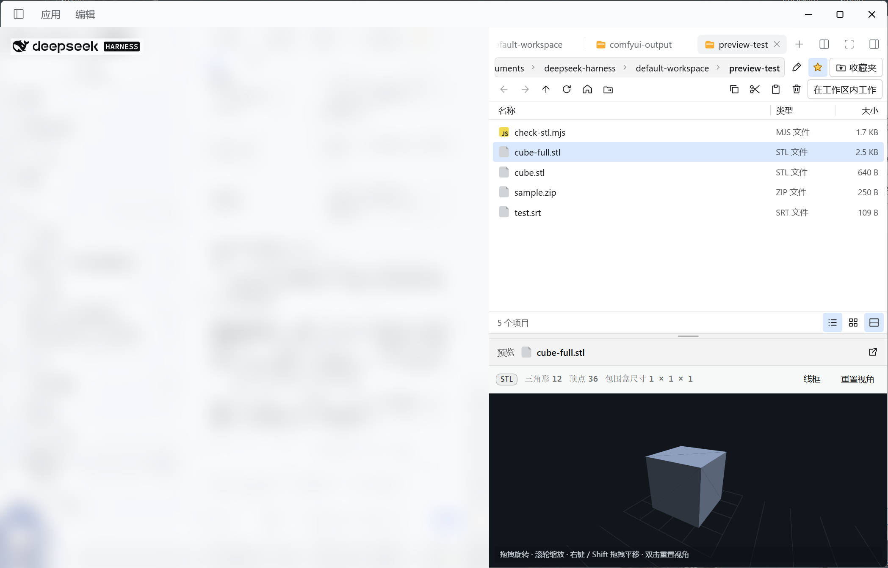

# DSH 工作区资源管理器

适用于 DeepSeek Harness 的 Windows 桌面插件。通过右侧栏原有的「文件浏览」入口浏览本机磁盘，并在下方独立预览文件。

## 安装

### 从 npm 安装（推荐）

```bash
dsh plugin --profile web add dsh-workspace-explorer
```

也可以在 Harness 的「插件 → 添加插件」里直接输入包名 `dsh-workspace-explorer`，让它自己解析注册表。

安装后从系统托盘完全退出 Harness，再重新打开右侧栏的「文件浏览」。

### 从 GitHub Release 安装

在 Harness 的「插件 → 添加插件」中粘贴下方安装包链接，也可粘贴已下载的本地 `.tgz` 路径：

```text
https://github.com/tm5452/dsh-workspace-explorer/releases/download/v1.0.0/dsh-workspace-explorer-1.0.0.tgz
```

已安装早期预览包或 `1.1.0-beta.*` 本地测试包的用户，先在插件列表移除旧条目，再重新安装。发布变更见 [版本记录](CHANGELOG.md)。

### 从源码安装

将插件目录以 `link:<绝对路径>` 添加。旧的同名插件记录可先从插件列表移除。

## 界面实拍

大图标视图、收藏夹和图片预览



**工作区搜索**

工作区模式会在结果中显示文件所在的子目录。



**多标签页浏览与管理**

在顶部标签栏打开和切换多个文件夹，可拖动标签调整顺序。每个标签页各自保留目录、导航历史和预览。



## 浏览本机磁盘

- 地址栏在第一行，右侧依次是编辑路径、收藏星标和收藏夹按钮。路径超出宽度时，在路径上滚动鼠标滚轮可左右查看。第二行提供导航、文件操作和工作区模式按钮。
- 用底栏切换列表和大图标。每个目录分别记住所选视图。大图标会为可解码的图片和视频显示内容缩略图。
- 预览窗格默认打开，可用底栏最右侧的按钮开关。拖动中间接缝调整上下高度，也可聚焦接缝后按方向键。关闭再打开会恢复刚才的比例。
- 双击文件夹进入目录。预览窗格打开时，单击文件即可查看。双击文件交给 Windows 默认应用打开。PDF 和 Office 文档也可以从预览栏交给 DSH 文档预览。
- 点地址栏右侧的编辑路径按钮，或在列表中按 Ctrl+L，可以粘贴 Windows 的绝对路径。目录路径打开列表，文件路径选择要预览的文件。
- 从列表或网格把文件拖入当前会话，文件会作为附件加入输入框草稿。单个拖入文件的读取上限为 32 MB。也可右键选择「复制文件路径」，将绝对路径作为文本粘贴。
- 把文件夹或路径栏中的某段目录拖到会话，会在输入框中插入绝对路径。拖到标签栏会为该目录新开一个标签页。
- 右键文件或文件夹可复制、剪切、粘贴、在资源管理器中显示、复制路径和重命名。复制和剪切使用 Windows 文件剪贴板。右键文件夹可粘贴到该文件夹，右键列表空白处可粘贴到当前目录。同名粘贴由 Windows 保留两份。包含符号链接或目录联接的项目可在 Windows 资源管理器中粘贴。
- 选中文件或文件夹后，可用第二行工具栏复制、剪切或删除。工具栏的粘贴始终使用当前目录。工具栏和右键菜单的「删除」都需要确认，并请求移入 Windows 回收站。
- 在列表或大图标视图中，按住 Shift 点选连续区间，按住 Ctrl 逐项选中或取消。复制、剪切和删除可批量操作，每次最多 128 项。多选时预览保留最近一次普通单击的文件。
- 点亮星标会收藏当前目录。收藏夹在地址栏下方悬浮展开，点击外部自动收起。可直接跳转、移除单条收藏或清空列表。收藏保存在本地配置中，移除或清空只更新保存的路径。
- 打开「在工作区内工作」后，该标签以当前会话的工作区为根目录。可按文件名关键词搜索所有可读取的子目录，点选结果会打开文件所在目录并预览。为避免循环和越界，搜索不遍历目录联接。结果最多显示 300 条。
- 「跳转至工作区」可手动进入当前会话的工作区。切换会话时，正在使用的文件浏览页保留目录、历史和预览。
- 点标签栏的「+」，再点「文件浏览」，可新开一个拥有独立目录、历史和预览的标签页。标签显示当前文件夹名。可按住标签拖动排序，标签超出宽度时可在标签栏上滚动鼠标滚轮。

本机磁盘访问仅在 Windows 桌面 Host 上启用，按启动 Harness 的 Windows 账户权限访问。粘贴和重命名会修改所选的本机文件或目录。Windows 拒绝访问时会显示提示。盘符首页只列本机磁盘、可移动盘和光驱。图片、音视频和扩展格式的内嵌预览最多读取 32 MB，文本预览读取前 2 MB。

## 构建

运行 `node scripts/build-client.mjs` 生成 `lib/client.js`。安装目录已包含构建产物。

扩展预览实现沿用 [dsh-preview-extra](https://github.com/LeiYuXingZhou/dsh-preview-extra)，许可证见 `LICENSE-preview-extra`。
