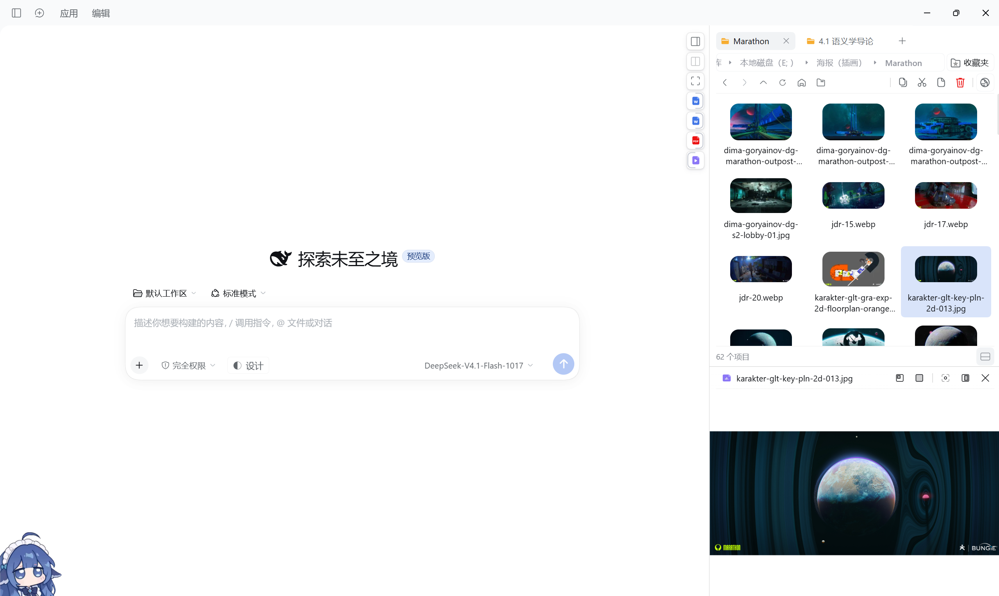
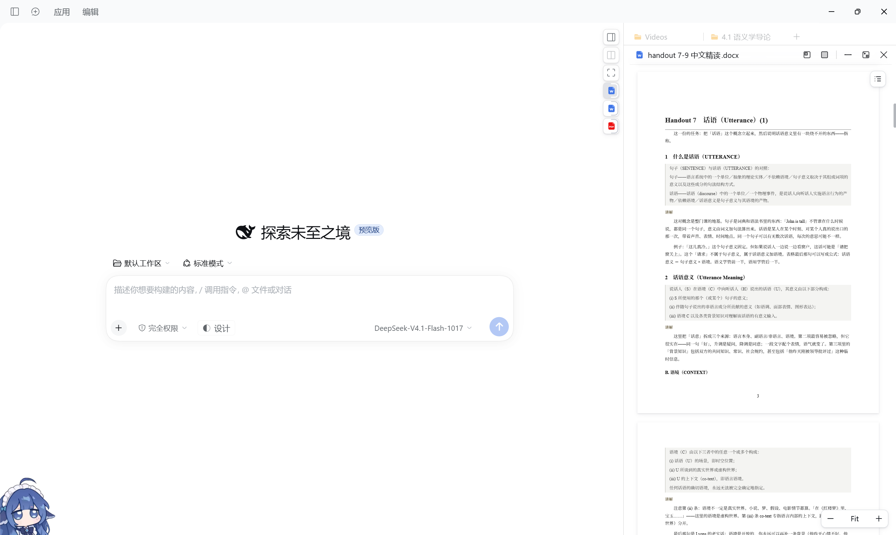
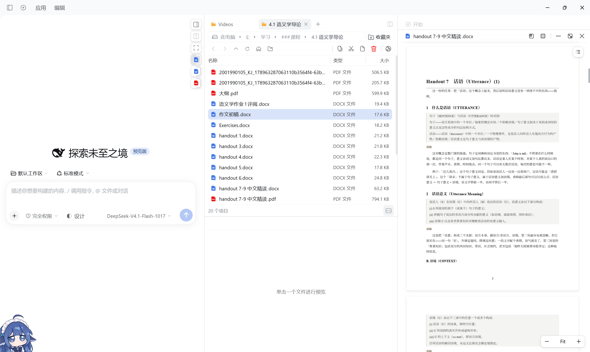
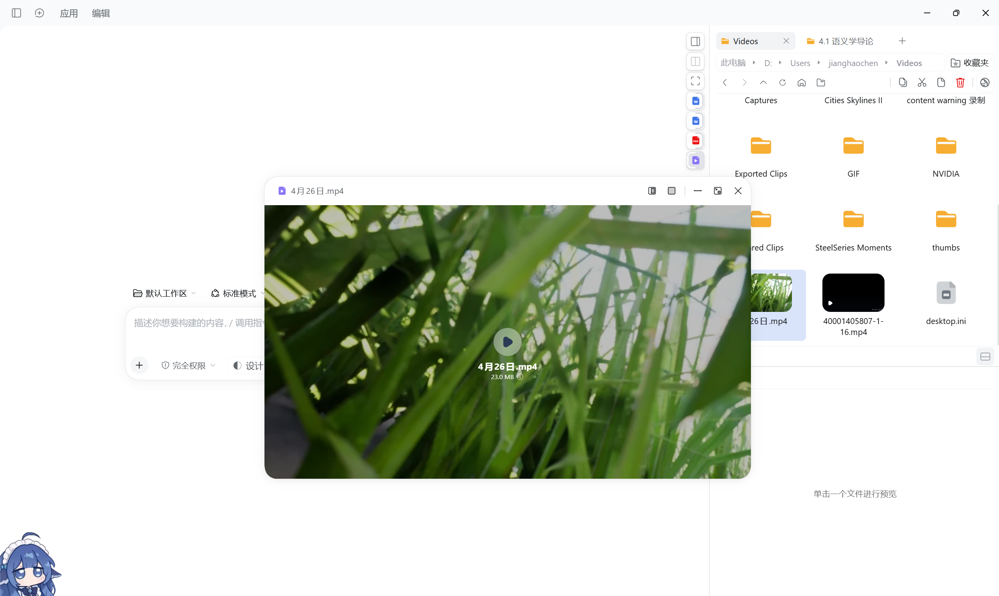

# DSH 工作区资源管理器

在 DeepSeek Harness 桌面端浏览本机文件、整理资料和预览文档。**适配 Windows、macOS 和兼容的 Linux 桌面宿主，支持在独立窗口中预览文件。** 你可以继续在文件列表里查找、复制或整理文件，同时在另一栏或浮窗里阅读文档、看图或播放媒体。

[下载 1.3.1](https://github.com/tm5452/dsh-workspace-explorer/releases/tag/v1.3.1) · [版本记录](CHANGELOG.md)

1.3.1 修复了关闭最后一个标签页后右侧栏可能失效的问题，并新增侧列快捷键拖放。上下拖动排序，向左打开小窗，向右打开侧栏。分屏时可将预览拖到指定窗格。

## 文件预览方式

- **单击快速预览。** 文件浏览页下方可以随时开关预览窗格。双击使用你在「设置 → 电脑文件资源管理器」中选定的打开方式。
- **按需切换预览位置。** 同一个文件可在下方预览窗、右侧栏、小窗和最大化预览之间切换。右侧栏和小窗使用一致的窗口控件，也支持返回文件浏览页的预览窗。
- **把常看的文件留在侧列。** 侧列快捷键能重新打开预览，悬停可查看文件名和所在窗口状态。收起预览后，右侧栏回到原来的浏览或工具界面。
- **阅读和播放接着进行。** PDF 在切换显示位置后保留阅读位置。音视频共用同一个播放器，移出下方预览窗时保留播放进度和暂停状态，音频胶囊可继续播放。

## 界面一览

### 侧栏入口

从右侧栏的「+」打开「电脑文件资源管理器」。点卡片主体进入当前会话的工作区，点右侧电脑图标浏览本机磁盘或宗卷。


### 资源浏览

在文件浏览页用多标签、路径栏、收藏夹和搜索找文件，支持列表与大图标视图。单击图片即可在下方预览，文件列表仍可继续操作。



### 侧列快捷键

将要反复查看的文件加入侧列，点图标即可恢复预览。图中的 Word 文档在右侧栏打开，其他文件仍可通过侧列快捷键访问。



### 分屏操作

把文件列表和独立预览放到相邻窗格。在一栏找资料、切换目录，另一栏继续阅读。



### 独立窗口

在 DSH 浮窗中预览视频、图片或文档，右侧栏保留资源浏览。小窗可移动、最小化、最大化，也可以重新停靠。



## 本地预览与依赖

**PDF 和 Office 预览在本机读取、解析和渲染。** 安装包内含 PDF.js、Office 预览引擎及其运行资源。打开文件时，DSH 的本机服务按需读取文件，桌面端在本机渲染。预览无需联网、CDN 或云端文档转换，无需另装 PDF 阅读器、Microsoft Office、LibreOffice 或 npm 依赖。

| 类型 | 支持范围 |
| --- | --- |
| 文档 | PDF、DOC / DOCX、XLS / XLSX、PPT / PPTX。PDF 按需读取并绘制可见页，Office 在后台 Worker 中解析文件，支持文档缩放和工作表切换。 |
| 图像和媒体 | 常见图片、音频和视频。图片支持缩放与平移，视频适配预览区域，音频可缩为音乐胶囊。 |
| 文本和其他格式 | 文本、Markdown、代码，以及部分压缩包、3D 模型等扩展格式。 |

预览本身只在本地处理。你主动把文件作为附件发送，或把选中的原文发送给会话时，内容由 DSH 按会话设置处理。文本、Markdown、Word、PowerPoint 和 Excel 支持在预览中选取内容并引用到会话。

## 安装与平台

需要能加载本插件的 **DeepSeek Harness 桌面宿主**。Windows、macOS 和兼容的 Linux 桌面宿主使用同一份安装包。磁盘和目录访问遵循运行 DSH 的账户权限。原生文件操作使用各系统的文件服务，Linux 上部分宗卷的回收站操作需要系统提供 `gio`。

在 DSH 的「插件 → 添加插件」输入 `dsh-workspace-explorer`，或从 [GitHub Releases](https://github.com/tm5452/dsh-workspace-explorer/releases/tag/v1.3.1) 下载 `.tgz` 后填入本地路径。用命令行也可以安装：

```sh
dsh plugin --profile web add dsh-workspace-explorer
```

使用本地测试包或目录链接的用户可以先移除旧条目。安装后完全退出并重新启动 DSH。

## 开源许可与致谢

本项目采用 [MIT 许可证](LICENSE)。安装包保留内置组件及其附带资源的版权声明和许可证。

- PDF 预览使用 Mozilla 的 [PDF.js 5.6.205](https://github.com/mozilla/pdf.js/releases/tag/v5.6.205)，采用 Apache-2.0。许可证随引擎、字体、CMap 和 WebAssembly 资源分发。 [PDF.js 许可与资源](assets/pdf-engine/)
- Office 预览使用 p10node 的 [office-engine 0.14.2](https://github.com/p10node/office-engine/tree/v0.14.2)，采用 MIT。本项目在嵌入版上适配了内容引用。 [Office 引擎许可证](assets/office-engine/LICENSE) · [内置组件版权声明](assets/office-engine/THIRD_PARTY_LICENSES.txt)
- 快捷键拖放使用 [Motion](https://github.com/motiondivision/motion) 的弹簧生成器，采用 MIT 许可证。[Motion 许可证](src/vendor/motion-spring/LICENSE.md)
- 部分扩展格式预览沿用 [dsh-preview-extra](https://github.com/LeiYuXingZhou/dsh-preview-extra)。 [扩展预览许可证](LICENSE-preview-extra)

贡献方式见 [贡献指南](CONTRIBUTING.md)。
