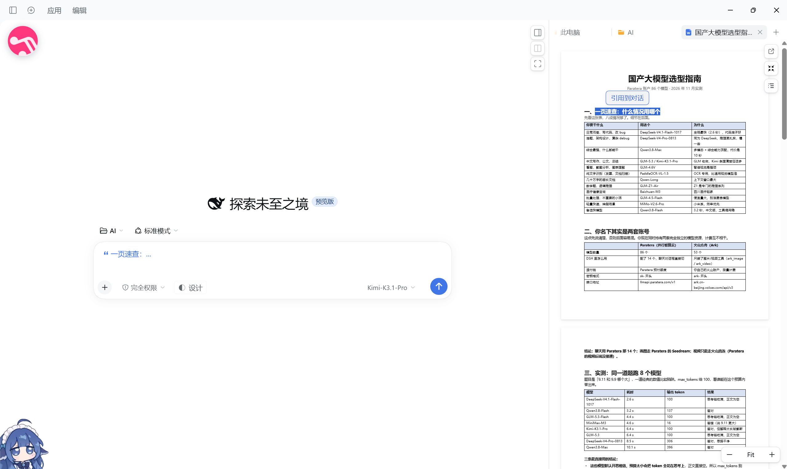
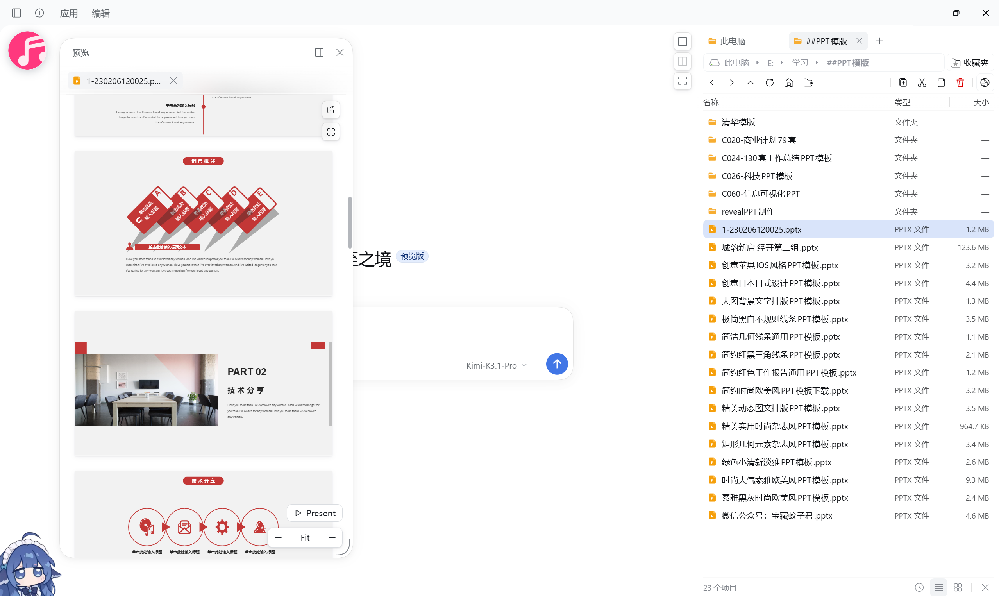
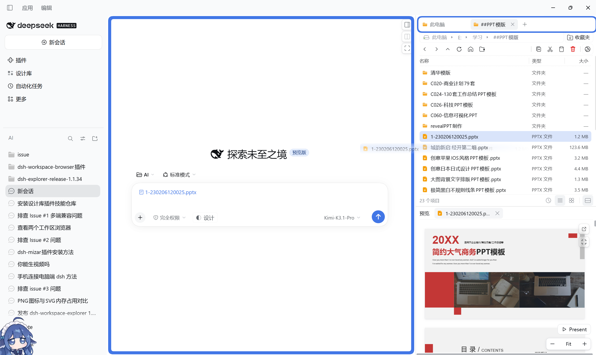
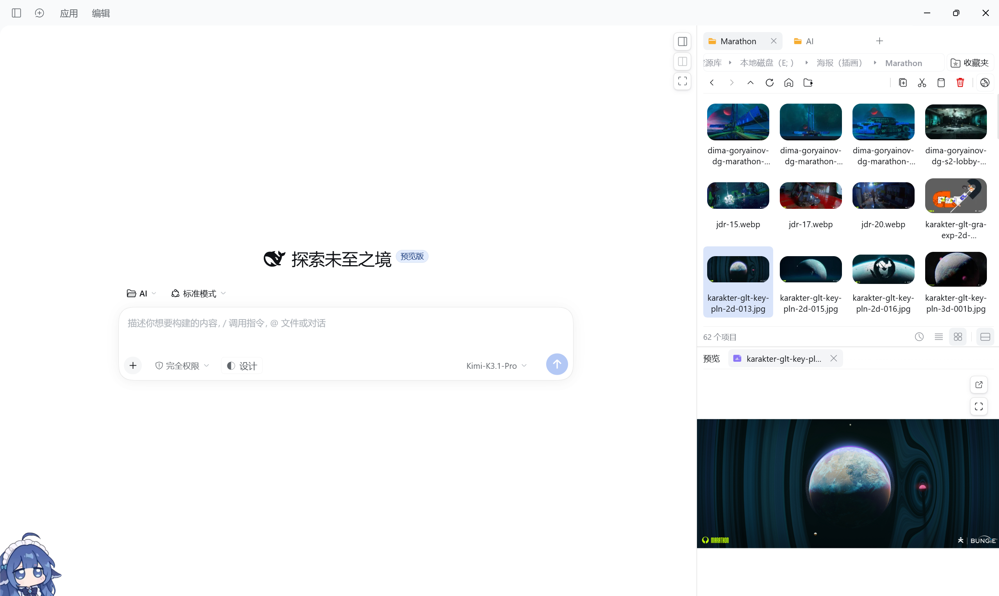
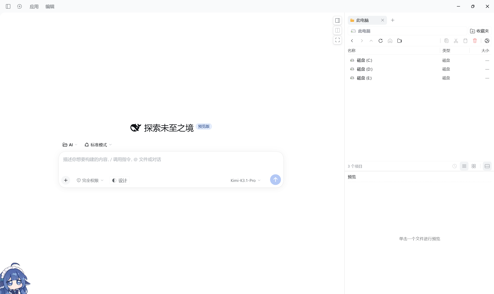

# DSH 工作区资源管理器

在 DeepSeek Harness 的右侧栏浏览本机磁盘和会话工作区、预览文档与媒体、整理文件，并把文件路径或选中的原文带进对话。插件适用于 Windows 桌面端，跟随 DSH 的亮色和深色主题，可与 Better Sidebar 一起使用。

## 1.2.2 更新

这一版重点改善 PDF 和 Office 文档的预览性能与浏览体验，加入文件内容引用和独立设置页。你可以在预览中选取原文放入会话，按自己的习惯设置文件浏览与会话的联动方式，也可以把整个预览窗格拖成 DSH 浮窗。 [完整更新说明](CHANGELOG.md#v122)

## 主要功能

- **文件浏览与整理** · 多标签浏览本机磁盘和工作区，支持收藏、列表与缩略图、文件搜索、批量操作和可配置的右键手势。
- **文档与媒体预览** · 在侧栏预览 PDF、Office、文本、图片和音视频。支持文档缩放、图片平移、视频全屏和音乐胶囊。
- **与会话联动** · 拖动文件来引用路径，或把预览里的原文、表格单元格和范围引用到对话。点击已发送的引用可打开原文件。
- **可分离的预览窗** · 拖动「预览」标题把整个窗格移到 DSH 浮窗，继续使用原来的预览标签和文件浏览联动。

## 找到文件，保留浏览位置

**浏览本机磁盘。** 点首页按钮回到「此电脑」，查看 C、D、E 等可用盘符。双击文件夹进入，页面只显示当前目录下的文件和子文件夹。工具栏可前进、后退、返回上一级和刷新。

**右键手势。** 打开右侧栏的「电脑文件资源管理器」后，从上半部文件管理区按住鼠标右键滑动，松手执行操作。向左后退、向右前进、向上返回上一级。分屏时操作手势起点所在的文件窗格。单击右键照常打开菜单。

**用路径直达。** 点地址栏中的任一级目录即可返回那里。路径太长时，把鼠标放在地址栏上滚动，可左右查看。双击地址栏空白处或按 Ctrl+L，可直接粘贴绝对路径。输入文件夹路径会进入该目录，输入文件路径会定位并预览该文件。

**同时打开多个目录。** 点顶部「+」再选「电脑文件资源管理器」，每个标签页各自保留目录、前进后退历史和预览。标签显示当前文件夹名，可拖动排序，放不下时可用滚轮左右查看。文件浏览标签默认独立于会话，也可按工作区或会话分别保存。

**每个目录记住自己的视图。** 底部可切换列表和大图标。列表显示名称、类型和大小。大图标可直接看到图片和可解码视频的缩略图。底部还可切换按修改时间排序，最近修改的项目优先。下次进入同一目录，会沿用上次的视图和排序设置。

**收藏常用目录。** 鼠标移入地址栏后，点右侧星标收藏当前文件夹。点击收藏项即可直达，进入收藏夹的编辑状态后可拖动排序、移除单项或清空收藏。

## 预览文档与媒体

**单击预览，双击打开。** 图片、音频、纯文本、PDF 和 Office 单击即预览。HTML、压缩包等格式通过封面按钮加载。视频封面会尝试显示首帧。无法识别为可预览内容的文件直接显示提示。双击文件可用 Windows 默认应用打开。

**控制下方预览窗。** 窗格默认开启，底栏右侧按钮可随时收起或展开。拖动上下窗格之间的细灰线可调整高度。文件名右侧的「×」可单独关闭当前文件预览。切换文件夹时可继续查看上一次选中的文件。

**保留下方预览标签。** 鼠标移到最左侧标签时，点击图钉固定它。预览另一个文件时，固定的标签会留在右边。可拖动排序，标签放不下时可用滚轮横向滑动。切换标签会释放预览内容，回到已经确认过的标签时直接重新加载。

**在独立标签页预览。** 把上方列表里的文件或下方预览标签拖到顶部标签栏，即可打开独立预览卡片并直接加载内容。拖到会话区则引用文件路径。

**分离整个预览窗格。** 拖动下半窗左上角的「预览」，松手后在该位置附近打开 DSH 原生浮窗。浮窗保留原来的预览标签、固定状态和文件浏览联动，可停靠回侧栏。文件浏览底栏最右侧也可关闭浮窗。

**在侧栏浏览文档并缩放。** PDF 和 Office 文档支持 Ctrl＋滚轮缩放。Office 由插件随附的 office-engine 在本地打开，Excel 可以切换工作表并沿横纵方向滚动。图片可直接用滚轮以鼠标位置为中心缩放，按住左键拖动可平移画布。右上角可打开 DSH 文档预览。

**把选区引用到当前对话。** 在文本、Markdown、Word 或 PowerPoint 预览里选中文字，或在 Excel 里选中单元格和区域，再点「引用到对话」。输入框里的长引用显示简写，悬停可查看完整原文。发送后会话里显示完整选区，模型同时收到文件路径、位置和原文。点击已发送的引用可在右侧栏打开原文件。Excel 单次最多可引用 1,000 个单元格。

**播放本机音视频。** 视频预览支持以指针为中心缩放、拖动平移和全屏播放。音乐可缩为胶囊继续播放，回到预览时保留播放进度。

| 类别 | 支持格式 | 预览内容 |
| --- | --- | --- |
| 图片 | PNG、JPG / JPEG、GIF、WebP、BMP、ICO、AVIF | 显示图片 |
| 视频 | MP4、WebM、M4V、MOV、MKV 等 | 尝试显示首帧，点击播放。取决于 DSH 内置浏览器能否解码 |
| 音频 | MP3、WAV、OGG、OGA、M4A、AAC、FLAC、Opus | 播放音频，同样取决于解码支持 |
| 纯文本与代码 | TXT、MD、JSON、CSV、PY 等 | 常见编码分段读取，滚动到段末加载下一段。支持按行定位，以及按 Python 文件头声明的编码预览 |
| 网页 | HTML、HTM | 小窗点击「打开网页预览」，独立预览直接加载。支持自包含网页 |
| 字幕 | SRT、VTT、ASS、SSA | 查看字幕时间和正文，也可切换到原始文本 |
| 字体 | TTF、OTF、WOFF、WOFF2 | 查看字体样张 |
| 3D 模型 | STL、OBJ、PLY、GLB、glTF | 旋转、缩放、平移模型，可切换线框。glTF 须内嵌模型数据 |
| 压缩包 | ZIP、JAR、WAR、APK、TAR、GZ、TAR.GZ / TGZ | 点击「解压预览」后浏览包内文件，按需查看条目 |
| 配置文件 | TOML | 按表查看配置键、类型和值 |
| 电路设计 | KiCad 原理图 .kicad_sch、PCB .kicad_pcb | 查看图形，支持缩放和平移 |
| 波形与光谱 | VCD、JCAMP-DX（.jdx、.dx） | 查看信号波形或光谱曲线 |
| 固件 | Intel HEX（.hex）、DFU（.dfu） | 查看数据地址、数据段和校验信息 |
| PDF 与 Office | PDF、DOC / DOCX、XLS / XLSX、PPT / PPTX | 单击文件直接预览，支持连续滚动和 Ctrl＋滚轮缩放 |

PDF 和 Office 使用本机字节范围接口。DOCX、XLSX、PPTX 在浏览器 Worker 内解析，并按可见页面或单元格绘制。旧版 DOC、XLS、PPT 由同一 Worker 在内存中导入。Office 预览无需联网。图片和音视频优先使用浏览器媒体读取。仍走整文件读取接口的其他格式上限为 32 MB。7Z、RAR 等压缩包可双击用 Windows 默认应用打开。

## 在会话与文件之间切换

**打开会话里的文件。** 点击 AI 交付的文件、改动卡片中的具体文件、本地文件链接或划词引用，默认在右侧栏定位文件并展开预览。可在「设置 → 电脑文件资源管理器 → 从会话中打开文件的方式」切换为「全屏文件预览」。拖到右侧标出的区域后，交付文件和文件链接打开 DSH 文档预览，改动卡片打开该文件的 DSH 差异审阅；按住 Shift 点击改动文件也可直接查看原生红绿对比。

**拖入会话引用路径。** 从插件或 Windows 资源管理器把本机文件或文件夹拖进当前会话的蓝框内，松手即在输入框插入文件引用块，提交时携带完整路径。右键菜单的「引用路径文本到对话框」插入普通文本，「复制文件到对话框」添加附件。

**拖动文件夹。** 列表里的文件夹和地址栏里的任一级目录都可以拖。拖到对话输入框，会插入该目录的路径引用块。拖到顶部标签栏，会为它新开一个文件浏览页。

**按需切到会话工作区。** 「跳转至工作区」只执行一次跳转。「工作区内浏览」会把该标签页的根目录限制在工作区，并显示搜索栏。在「完全独立」设置下，切到其他工作区时会新开或复用对应的工作区标签。退出模式可回到之前的普通浏览位置。

## 就地整理文件

**单项和批量操作。** 右键文件或文件夹，可复制、剪切、粘贴、重命名、复制路径、在 Windows 资源管理器中显示或删除。按住 Shift 可选连续区间，按住 Ctrl 可逐项选中或取消。多选后可批量复制、剪切或删除。

**与 Windows 剪贴板配合。** 工具栏的粘贴会把文件放进当前目录，右键某个文件夹则可直接粘贴到该文件夹内。同名粘贴会保留两份，删除需确认后移入 Windows 回收站。

## 自定义偏好

在「设置 → 电脑文件资源管理器」中可以调整以下选项。

- 文件浏览标签与会话的关系。可选完全独立、按工作区切换或按会话切换。
- 从会话中打开文件的方式。可选定位到文件并显示预览，或直接打开全屏文件预览。
- 通过顶部「+」新建标签时是否默认显示预览窗格，以及未选中的工作区标签是否自动折叠。
- 收藏夹和工作区内浏览按钮是否显示文字。可选常态展开、自动折叠和常态折叠。
- 右键手势开关，以及四个滑动方向各自对应的操作。

## 界面实拍

**Word 文档预览与划词引用**



**分离预览窗**



**拖动文件到会话**



**大图标视图与图片预览**



**「此电脑」与列表视图**



## 权限与限制

本机磁盘访问仅在 Windows 桌面 Host 上启用，按启动 Harness 的 Windows 账户权限访问。粘贴和重命名会修改所选的本机文件或目录，Windows 拒绝访问时会显示提示。盘符首页只列本机磁盘、可移动盘和光驱。Office 文件的可预览范围取决于 office-engine 的格式支持、解压限制和系统可用内存。音视频在桌面协议不支持跳转时，会完整读取到浏览器可跳转的来源。批量操作每次最多 128 项，工作区搜索结果最多显示 300 条，且不遍历目录联接。

## 参与贡献

欢迎通过 Pull Request 提交可选的扩展功能。扩展可在「设置 → 电脑文件资源管理器 → 扩展功能」里作为开关或下拉选项，用户可自行启用、关闭或选择模式。需要界面入口的功能可以接入侧列快捷键栏、文件预览侧列按钮栏，或使用文件浏览工具栏和底栏的扩展接口。插件本体的功能建议可在 Issues 讨论，由维护者负责实现。

- [扩展接入方法与 PR 提交流程](CONTRIBUTING.md)
- [界面设计规范](docs/ui-design.md) · [界面区域标注图](docs/界面规范.png)

### Contributors

- [tm5452](https://github.com/tm5452) · 项目维护与界面设计。
- [Codex](https://github.com/codex) · AI 编程协作者，参与功能实现、测试与文档维护。

## 许可证

本项目采用 MIT 许可证，详见 [LICENSE](LICENSE)。

扩展预览实现沿用 [dsh-preview-extra](https://github.com/LeiYuXingZhou/dsh-preview-extra)，原版权声明与 MIT 许可证见 [LICENSE-preview-extra](LICENSE-preview-extra)。

## 下载与安装

### 从 npm 安装

在 DSH 中打开「插件 → 添加插件」，输入 `dsh-workspace-explorer`。也可以在终端运行以下命令。

```bash
dsh plugin --profile web add dsh-workspace-explorer
```

### 从 GitHub 下载

从 GitHub Releases 下载正式版的 `.tgz` 安装包，然后在 DSH 的「插件 → 添加插件」中填入安装包的本地路径。也可以直接粘贴对应的下载链接。 [GitHub Releases](https://github.com/tm5452/dsh-workspace-explorer/releases)

### 从源码安装

在插件目录运行 `npm install` 和 `npm run build`，然后在 DSH 中添加 `link:<插件目录的绝对路径>`。正式安装包已包含构建产物。

安装后，从系统托盘完全退出 DSH，再重新打开。点击右侧栏的「+」，选择「电脑文件资源管理器」。卡片主体打开会话工作区，右侧电脑按钮直达「此电脑」。已有本地测试包或源码链接的用户，可以先移除旧的同名插件条目，再安装正式版。
