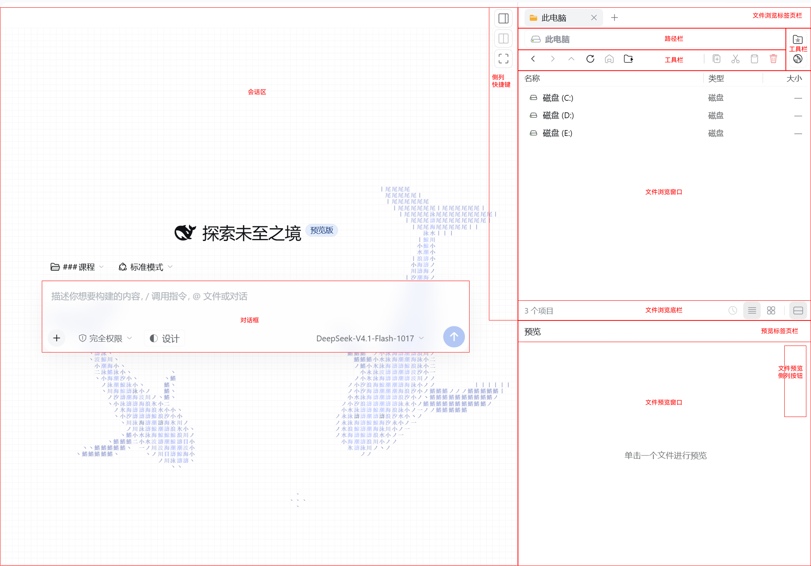

# 工作区资源管理器界面设计规范

本规范适用于电脑文件资源管理器的界面设计、实现和扩展评审，覆盖文件浏览、文件预览、会话联动及设置。除设置页按宿主字号缩放的尺寸外，下文尺寸均为 CSS 像素。

会话区、文件浏览窗口、预览窗格和各工具栏的位置与名称见标注图。

## 总体原则

- **融入 DSH。** 会话、右侧栏外壳、原生浮窗和设置入口沿用宿主组件。插件区域复用宿主的文字、主题、焦点和浮层样式。插件新增的控件与同区域现有控件共享尺寸、间距和状态色。
- **按操作分区。** 标签切换放在标签页栏，目录导航和文件操作放在路径栏及工具栏，视图与窗格控制放在文件浏览底栏。预览的窗口操作放在顶栏，媒体、文档和扩展操作放在文件预览侧列。
- **优先保证内容可操作。** 栏宽变小时，保留固定操作和主要内容，标签与工具组按各自规则横向滚动。界面支持亮色、深色、键盘操作和减少动态效果。
- **保持图标语义一致。** 同一动作在相同语境下使用同一图形。文件类型的颜色和细分标记一起表达格式，装饰图标不参与朗读。图标按钮有可访问名称，提示文字与实际动作一致。

## 区域与布局

| 区域 | 布局与操作 |
| --- | --- |
| 会话区、对话框 | 使用 DSH 的原生布局。侧列快捷键位于会话区右上侧，在分隔线左边。 |
| 右侧栏 | 首次打开时以窗口宽度的 30% 为默认值，由 DSH 处理窄窗口和分屏限制。用户调整后沿用调整值。 |
| 文件浏览标签页栏 | 置于右侧栏顶部，标签超宽时可横向滚动。新建入口始终可用，拖动排序时给出跟随图标和插入位置提示。 |
| 路径栏、工具栏 | 面板两侧基本内距 10px。收藏夹靠路径栏右端。工具栏左侧为导航，右侧为文件操作和工作区入口。 |
| 文件浏览窗口 | 列表表头固定在顶端，名称、类型和大小文字使用当前前景色的 80%。面板宽度不超过 380px 时隐藏类型列，名称与大小保持同排。大图标视图的文件名保留两行高度。 |
| 文件浏览底栏 | 左侧为状态，右侧为排序、视图、扩展操作和预览窗格按钮。分离预览后，最右侧改为关闭小窗按钮。 |
| 预览顶栏 | 下半窗和侧栏独立预览共用 35px 高的顶栏。左侧文件名区域高 28px、圆角 8px，常态透明，悬停显示按钮底色。窗口操作集中在右侧。 |
| 文件预览窗口 | 正文起始位置留在标签页栏下方，滚动或平移时可延伸到透明栏后方。 |
| 文件预览侧列按钮 | 右侧内距 20px，距内容可视区顶端 10px。媒体按钮、文档大纲和扩展按钮按各自用途排列。 |

### 布局与工作流

- 路径栏显示当前目录层级。点击目录名进入该目录，双击路径栏空白处进入编辑，按 Enter 提交，点击栏外或按 Esc 退出编辑。
- 文件列表保持「名称、类型、大小」的阅读顺序。大图标视图为每个名称留出固定的两行空间，缩略图保持纵向对齐。文件夹和普通文件的图标使用共同的对齐基线。
- 文件浏览标签拖动排序时显示插入线。预览顶栏的文件名支持拖到会话引用路径，侧栏独立预览还可拖动到原生分栏。拖文件到会话区或文件浏览标签页栏时用蓝色轮廓标明目标区域，进入目标后轮廓加粗，出现、变化及退出使用短动画。
- 下半预览窗显示当前文件。预览窗格分离、停靠或切换呈现方式时，沿用当前文件与阅读或播放状态。文件浏览与会话之间的联动遵循当前设置。

## 按钮、标签和图标

| 元素 | 点击区域 | 图标与间距 | 圆角 |
| --- | --- | --- | --- |
| 工具栏、文件浏览底栏 | 28×28px，窄栏的工具栏可以横向滚动 | 常用 SVG 外框 22×22px，图案居中缩放到原始比例的 80%。同组间距 2px | 8px |
| 侧列快捷键 | 28×28px，1px 边框 | 图标跟随会话右上角的原生菜单图标尺寸，回退 16×16px。行距 3px | 8px |
| 文件预览侧列按钮 | 28×28px，1px 细边框 | SVG 外框 18×18px，行距 6px | 8px |
| 收藏夹、工作区内浏览 | 折叠时与所在工具栏同高。常态展开、自动折叠、常态折叠三种模式 | 展开后标签右侧留 8px。悬停延时 50ms，常规动画 130ms，键盘聚焦可展开 | 8px |
| 预览顶栏按钮 | 28×28px | SVG 外框 16×16px，常态透明，使用主题前景和统一的悬停反馈 | 8px |
| 播放及其他媒体专用按钮 | 按媒体卡片尺寸计算 | 播放键、进度条端部、封面和胶囊用圆形几何 | 圆形或半圆端部 |

可用按钮悬停或按下时显示反馈色，移开后回到自身的常态或激活底色。工具栏中可切换状态的按钮用 `aria-pressed`，设置页的开关用 `role="switch"` 和 `aria-checked`，弹层入口按其语义提供展开状态。普通工具和扩展按钮共用以下规则。

| 状态 | 前景 | 背景与边框 |
| --- | --- | --- |
| 可用、常态 | 预览侧列的图标统一用 DSH 主标签色，亮色回退 `#212529`，深色回退 `#EEEEEE` | 路径栏、工具栏和文件浏览底栏为透明。其他普通按钮亮色用 `#FFFFFF`，深色用 DSH 背景，回退 `#151517` |
| 悬停与按下 | 预览侧列保持同一图标色 | 亮色 `#E1E3E8`，深色 `#30333A` |
| 已激活 | 保持可读前景。收藏星标采用橙黄色激活图标，删除属于独立的红色语义 | 亮色 `#F1F3F5`，深色 `#26282E` |
| 禁用 | 普通工具整体 40% 不透明。预览侧列将主标签色以 40% 混入常态底色。侧列快捷键使用专用禁用色 | 使用常态底。路径栏、工具栏和文件浏览底栏仍为透明。禁用悬停反馈与点击 |
| 键盘焦点 | 保持可读前景 | 2px 焦点环。设置使用 `#3F6FE6`，侧列扩展使用主题强调色 |

文件浏览工具栏图标在亮色模式使用 `#61666B` 和 `#ADB2B8`，在深色模式使用 `#C0C2C4` 和 `#64696E`，分别对应可用和禁用。删除图标沿用独立状态色，各图标保留 SVG 自带的填充透明度。

侧列快捷键前景色在亮色模式为可用 `#64696E`、禁用 `#C0C2C4`。深色模式为可用 `#C0C2C4`、禁用 `#64696E`。文件预览侧列和侧列快捷键在常态、悬停、激活和禁用时，背景均为 80% 透明（20% 不透明），叠加 3px 背景模糊。图标、边框和阴影独立绘制。亮色阴影为 `0 1px 2px #0F172A1A, 0 2px 8px #0F172A0F`，深色为 `0 1px 2px #00000080, 0 2px 10px #00000073`。播放键、进度控件、设置开关和文件类型图标使用各自的尺寸与几何。

## 浮窗、弹出层与预览内容

- 独立小窗在 44px 高的 DSH 原生标题栏显示文件图标与名称。侧列快捷键提供对应的单文件入口。
- 侧栏独立预览的文件名行与文件浏览标签页栏之间使用 DSH 分栏线。上方标签的文字和图标淡显，悬停于某个标签时恢复该标签的颜色。
- 划词「引用到对话」使用文件浏览标签页的选中底色和圆角，沿用同一字号变量，回退 13px。高度 28px，左右各留 10px，文字及 1px 描边使用 DSH 链接蓝，阴影使用独立按钮的双层参数。悬停时底色混入 10% 黑色，保持不透明。对话框中的引用超过五字时显示简写，悬停提示显示位置和完整原文。
- 文件右键菜单按原分组绘制独立面板。每项 13px、400 字重、20px 行高，行高至少 34px。图标 14px，图文间距 6px，内边距为上下 6px、左右 8px。面板采用 DSH 菜单底色、大圆角和轻描边，圆角回退 12px。组内分隔线高 0.5px，两侧各内收 8px，上下间隔 3px。点击面板外或按 Esc 关闭。
- 文件预览的关闭、加载和不可预览状态使用明确的文字与操作。文档工具放在标签页栏下方，文档内容可以在栏后滚动。图片缩放以指针为锚点，画布空白处也可拖动。达到拖动阈值时显示抓取反馈。视频按原比例适配预览区域。
- 文件预览的切换按钮放在最小化与最大化之间。从下半窗打开时显示「侧栏打开」「小窗打开」，从侧栏打开时显示「小窗打开」「返回预览窗」，从小窗打开时显示「侧栏打开」「返回预览窗」。最大化后的恢复返回原窗口形态。媒体全屏使用专用图标及提示文字。

## 两条半透明栏

适用于**预览标签页栏**和**文件浏览列表表头**。背景、模糊和分隔线共用同一规则，标题文字与控件绘制在上方。

| 参数 | 亮色模式 | 深色模式 |
| --- | --- | --- |
| 渐变底色 | `#FFFFFF` | `#151517` |
| 底色不透明度 | 顶部 100% 到底部 25%，线性渐变 | 顶部 100% 到底部 25%，线性渐变 |
| 上分隔线 | `#FFFFFF`、60% 不透明，1px，接左右边界 | `#FFFFFF`、10% 不透明，1px，接左右边界 |
| 下分隔线 | `#808080`、10% 不透明，1px，两端各内收 10px | `#232325`、30% 不透明，1px，接左右边界 |

两根线在栏底连续相贴。目标模糊从顶部到 50% 保持约 20px，在 75% 处约 10px，底部约 3px。实现由 3px 基层、9.54px 渐隐到栏底的中层、17.32px 从 50% 到 75% 渐隐的上层组成。中层在 0–75% 和上层在 0–50% 的遮罩不透明度都是 100%。背景层不拦截指针，标签和按钮可独立交互。

## 设置界面

设置页正文使用 DSH 标准正文大小 `--dsh-content-font-size`，回退为 14px。以下尺寸以 15px 正文为比例参考，文字、控件和留白会随实际正文字号缩放。

| 元素 | 尺寸与排版 | 亮色 | 深色 |
| --- | --- | --- | --- |
| 分组标题 | 22px、700 字重，行高 1.17 | `#000000` | DSH 白色中性色，回退 `#FFFFFF` |
| 正文、标签和选项 | 15px、400 字重，行高 1.25 | `#000000` | DSH 主标签色，回退 `#D6D9DF` |
| 注释 | 11px，紧跟对应标签。描述行为或适用范围 | `#B2B7BD` | DSH 三级标签色，回退 `#A4AAB4` |
| 下拉框 | 高度至少 2.4em、圆角 .7em。弹层圆角 .85em，选中项右侧显示对勾 | 入口 `#F5F6F7`，弹层用 DSH 菜单底色，回退 `#F8F9FA` | 入口 `#292B30`，弹层用 DSH 菜单底色，回退 `#303136` |
| 行内图示 | 28×28px，圆角 8px | `#EFF1F2` | DSH 悬停底色，回退 `#292B30` |
| 开关 | 跑道形轨道高 1.45em、宽高比 58∶32。轨道两端为半圆，半径等于轨道高度的一半。内侧滑块是正圆，直径为轨道高度的 26/32 | 开启 `#0F1115`、关闭 `#E0E0E0`，白色圆钮 | 开启为 DSH 主标签色，回退 `#D6D9DF`，配 `#151517` 圆钮。关闭为 `#44464E`，配白色圆钮 |
| 分组细线与手势框 | 1px，手势框圆角 21px | `#AAB0B7` | DSH 三级边框色，回退 `#50545B` |

设置页随宿主内容区铺满可用宽度。宽布局采用左说明、右控件两列，右列占可用宽度的 38%。内容容器不超过 25em 时，常规控件排到对应文字下方。手势框宽度在宽布局为内容区的 70%，窄布局为 100%，内部保留方向与选择两列。扩展设置放在底部「扩展功能」组，使用相同的开关或下拉框组件。空组自动隐藏。

开关的外轨和滑块由同一 SVG 的圆头轨道与正圆绘制，等比缩放。圆钮垂直居中，停在任一端时，上下与外侧间距均为轨道高度的 3/32。关闭时在起始侧，开启时移到结束侧，位移动画 140ms。整个轨道可点击，也可用 Tab 聚焦并通过空格或 Enter 切换。下拉菜单在当前选项右侧显示对勾，支持键盘选择和 Esc 关闭。

## 实现与验收

- 共用颜色、间距、控件尺寸与动效在 [界面样式](../src/ui/styles.js) 统一定义。图标通过 [图标组件](../src/ui/interface-icon.js) 接入。文件类型标记及媒体控制遵循各自的专用尺寸和语义。
- 扩展使用 [设置组件](../src/ui/preferences.js) 和 [扩展按钮组件](../src/ui/extension-controls.js)，插入已有工具区域并继承其状态样式。扩展入口、接入约定和审核流程见 [贡献指南](../CONTRIBUTING.md)。
- 验收覆盖亮色与深色、窄栏与宽栏、停靠与浮窗，以及常态、悬停、已激活、禁用和键盘焦点。检查控制位置、文字与图标的可读性、滚动内容的可见范围和拖动反馈。
